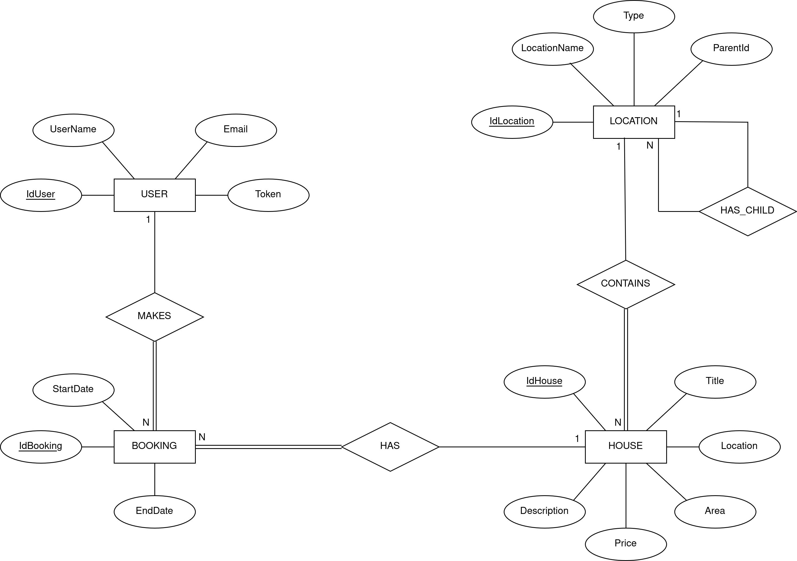

## Introduction

This document contains the relevant design and implementation aspects of LS project's first phase.

## Modeling the database

### Conceptual model ###

The following diagram holds the Entity-Relationship model for the information managed by the system.



We highlight the following aspects:

- A booking is made by a single user, necessarily, and a user can make many bookings;
- A house can have many booking, and a booking must have, necessarily, one house;
- A house has to have a location, necessarily, and a location can have many houses;
- A location can have many children, but can only have one parent.

The attributes of each entity were defined in this phase's requirements, the only additional attribute being the token
of the USER entity, since we don't use the token as an id itself.

The conceptual model has the following restrictions:

- All attributes in the ER diagram are NOT NULL, except ParentId.

#### Why we chose surrogate keys as primary keys

We decided to stick to surrogate keys only, which is why even when we had good natural keys, such as the token in the
user entity,
we still decided to create a separate attribute UserId.

This was done because of consistency, we always know that the identifier name of a particular
entity is going to be its name, and the Id suffix, in Pascal Case, e.g. UserId, LocationId, etc...

### Physical Model ###

The physical model of the database is available in [here](../../../../../sql/HouseRentalsDB.sql).

We highlight the following aspects of this model:

- Since we decided to use surrogate keys, we let the database create these Ids automatically with GENERATED ALWAYS AS
  IDENTITY. We could have also used GENERATED BY DEFAULT AS IDENTITY to keep the ability to override certain Ids if we
  wanted, but we saw no use for that in our project.

## Software organization

### Open-API Specification ###

Our Open-API specification is available [here](houseRentals-api-spec.yaml).

We decided to implement the specification in yaml because it's easier to read and is less verbose than json.

In our Open-API specification, we highlight the following aspects:

### Request Details

Before the request reaches the defined routes, it first goes into our filter, defined
in [ServerUtils.kt](../../ls/houses/server/ServerUtils.kt) in the server package.
This is where our error handling is done. When it matches a route, it goes to the corresponding WebApi function, as
defined in
[Server.kt](../../ls/houses/server/Server.kt).

WebApi layer then checks the path parameters and queries. We try to convert them to their correct type,
if it fails we throw an error which is handled in our filter.
For body validation, we try to decode the body directly into the DTOs we defined in webapi/dtos, and catch errors thrown
by the serializer library, like MissingFieldException, directly in the filter. This is something to improve in the next
phase.

If it passes type checks and has everything it needs, the request's extracted data proceeds from the webApi into
services. This is where we check for business logic errors. We check for example if startDate is greater than endDate,
if the Id for the Location passed matches an actual location, etc.

From the services layer we then call the data layer, with the corresponding function, which gets us the data we need or
creates some record. After this, through return statements used in the layers above, this data bubbles its way up again
to the WebApi layer, where it's encoded our response, put in the body, and sent back to the client. The status code to
be
sent is also defined in WebApi.

### Connection Management

We create a connection for every method of the various DataPostgresql classes (BookingDataPostgresql,
LocationDataPostgrsql, etc...).
We use (and create) connections through the connection property, and use function the .use{}, which when it finishes to
run its block of code, automatically closes it's connection.

### Data Access

We created the classes BookingDataPostgresql, LocationDataPostgrsql, HouseDataPostgrsql, UserDataPostgrsql, where each
is
of these is responsable for the data operations of their purpose. We then merge them all into a DataPostgrsql class.

The most complex queries made in this project were performed in the functions getHierarchy and getAvailableHouses,
located in LocationDataPostgresql.kt and BookingDataPostgresql.kt respectively.

In the getHierarchy function we used the WITH RECURSIVE SQL statement so that it allows as to do checkings through the
different hierarchy layers. It works like this: the first SELECT statement after the WITH RECURSIVE statement is the
starting point, so in this SELECT statement we pass the id of the location at the lower part of the hierarchy (
locality),
after this the next SELECT statement looks for the parent location of the location obtained in the previous SELECT
statement by looking for the at the matching locations with attributes ParentLocation and IdLocation. After this first
iteration the parent location obtained previously now is going to check for this parent the same way. This cycle ends
when there are no locations that have matching IdLocation and ParentLocation attributes. The SELECT statement in the end
returns us all the locations obtained during all the iterations of this cycle which represent the complete hierarchy.

In the getAvailableHouses function we join the HOUSES table with the BOOKING table when both have matching house ids and
both of these are true: the start date at the database is lower or equal than the one passed as parameter and the end
date
at the database is higher or equal than the one passed as parameter - this condition gets us the occupied houses
(which are not available). The LEFT OUTER JOIN here is important, it works together with the WHERE B."IdHouse" IS NULL
statement:
the WHERE statement gets the houses that had no match in the join (the available ones), however if we used the INNER
JOIN
statement here we wouldn't be able to access the available houses because they wouldn't have passed the JOIN statement,
so the LEFT OUTER JOIN statement returns us all the HOUSES including the ones that don't pass the JOIN condition and
then
all we need to do is to filter the results with the WHERE statement.

### Error Handling/Processing

Errors are handled by the filter defined in [ServerUtils.kt](../../ls/houses/server/ServerUtils.kt). This filter is
executed before the requests gets to the routes. We wrap the HttpHandler in a try catch. This handler will then match
with a route, if any, then go to WebApi, services, data, etc...

We created our own exceptions, defined in [Exceptions.kt](../houses/exceptions/Exceptions.kt).

We did this by implementing a base class, HttpException (which itself inherits from Throwable), from which all the more
specific exceptions will inherit.
This class stores an http status code, and a message.

If exceptions are thrown at any of those layers, they are caught in the filter.

When an exception is caught, it can go into one of the following catch blocks:

- The first catch catches HttpException, which is the exception we defined;
- The second catch catches MissingFieldException, which occurs when Json.decodeFromString fails to decode a json payload
  because a field is missing
- Lastly, it's just a generic Exception, to catch everything uncaught until now. This happens when an exception we
  didn't anticipate happens.
  We don't give any information on purpose for security reasons. Although this is an academic project, where security
  doesn't matter, in production, giving information of unhandled behavior could give hackers levarage on how
  to exploit our api. It's why we just send an internal server error.

We wanted to catch kotlinx.serialization.json.internal.JsonDecodingException, which happends when the request sent type
for a property is not what was expected, but couldn't because we can't import this exception. We suspect it's because
it's "internal".

We could have just wrap the Json.decodeFromString in a try catch block, and when it throws, gives a generic message, for
example "Failed to decode json payload", but we wanted something more specific about what exactly failed, and what we
tried didn't work out.
This is something we will have to work on in the next phase.

## Critical Evaluation

### Functionality that is not concluded and the identified defects:

- We have to improve our error handling for malformed json payloads. Right now, we only handle one scenario, where a
  field isn't present, but others are unhandled and result in a 500;
- We didn't implement price prediction functionality;
- Our current authentication method breaks the dependency injection, because it requires data to be injected into
  WebApi;
- The error responses' payloads are currently given in plain text, instead of in json;
- Then we have some smaller things, identified by the TODOs in the code.

### identify improvements to be made on the next phase:

- Fix the defects above;
- We ought to finish making automated tests for all layers, our testing was mainly done through the .http file, which
  requires manual testing and is time-consuming to test with.
- Split the data layer into multiple files, just like we did for all the other layers.
  The data layer is split, but then we merged them all into one data. We'll have to revert this.


### Single Page Application (SPA)
We developed a single page application that interacts with our API and dynamically generates the HTML code without
reloading the page.

The SPA can be accessed through following the link [http://localhost:8000/](http://localhost:8000/).

Our SPA has the following structure:
- 2526-2-LEIC44D-G02/
  - ...
  - static-content/
    - sparouter/
      - dsl-functions.js
      - handlers.js
      - index.js
      - router.js
    - index.html

**index.html**: The one and only HTML file that our server sends. 
It's the website template. Inside the body tag we have
a div with an id, _mainContent_. From the JS code, we use ```document.getElementById("mainContent")``` to access this div
and use the ```replaceChildren()``` function change the contents of the website.

**dsl-functions.js**: This is where we have defined our Domain Specific language (DSL) and some helper functions that help
reduce boilerplate.

**router.js**: 
This is where we have the data structure that holds the routes information, in our case, an array, and functions
that interact with the routes, namely:
- ```addRouteHandler(pathTemplate, handler)```: Adds a route to the router by specifying the path, _pathTemplate_, and the 
function which should be executed for that path, _handler_.

- ```addDefaultNotFoundRouteHandler(afdsf)```: Allows overriding the behavior of when the path is not 
in the router, which by default is set to just throw an exception, which is stored in the _notFoundRouteHandler_ variable.

- ```getRouteHandler(path)```: An algorithm to check if the passed path corresponds to any one of the stored routes. 
If the correspondence exists, the function returns the handler of that route. If it doesn't it returns 
_notFoundRouteHandler_

**handlers.js**: This is where we have the handlers (functions) associated with each route.

**index.js**: The file where we assign functions to events, which is where the execution flow starts.

#### Flow of execution in the SPA

In the index.js file, we have attached functions to 2 event handlers:
- load: triggers when the page is first loaded, or when there's a reload of the page;
- hashchange: triggers every time the anchor of the page (everything that proceeds the # in the URL) changes;

The function attached to the load event handler adds all the routes, defines the custom behavior for what should be done
when a route doesn't exist.

The function attached to the hashchange handler grabs the values of the current anchor, and checks if there's a handler
for that route.
If there is that handler will execute. Most handlers will define links with anchors too, which when clicked will
trigger the hashchange event again, and keep the page moving forward.